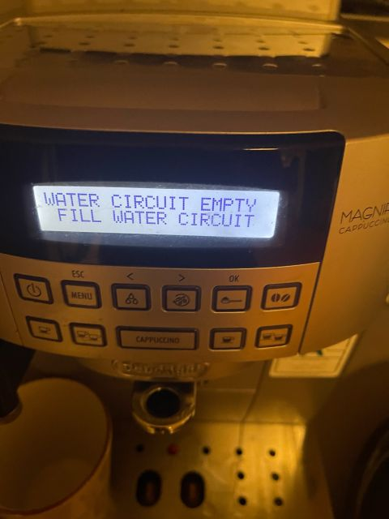

After finally settling down, one thing I absolutely wasn't willing to lose was my morning coffee with De'Longhi .

A few days ago, my trusted #DeLonghi suddenly stopped making coffee. The grinder worked; the water heated up and pumped. Everything sounded normal. But nothing came out.

Instead, I found a completely dry coffee puck, compressed so hard it looked like the machine had given up on life.

A few years ago, I would have done what most people used to do:

	•	Assume it's broken.
	•	Buy a new machine for 4,000+ SEK.
	•	Or send it for service and pay hundreds just for someone to diagnose it, plus another thousand to replace the component or fix it.

This time, I did something different. Since we have AI now, I described the symptoms to Microsoft Copilot with some photos and descriptions.

After a few rounds of troubleshooting, it pointed to a worn sealing ring in the brewing unit. It explained why pressure was building up in the wrong place and even helped me find replacement options online, sending me the links directly.

In the end, it was me who fixed the coffee machine myself. However, AI helped me understand the problem well enough to make a confident decision.

That's the real value: AI helping us bridge the gap between something is wrong and knowing how to fix it.

Free Copilot helped me revive the coffee machine—a repair that saved several thousand kronor. Through my #ClaudePro subscription, I've built DIY solutions to replace numerous SaaS, PaaS, and IaaS services, which has delivered significant cost savings.

Maybe the biggest shift isn't AI itself. Maybe it's learning to ask better questions and fully use the potential of your AI tools.

#AI #Copilot #ClaudeCode #ProblemSolving #DIY #Technology #Productivity

---

**Engagement:** 👍 3 likes • 💬 0 comments • 🔄 0 shares

*This post was automatically synced from LinkedIn on 11/5/2026.*

**Original LinkedIn Post:** [View on LinkedIn](https://www.linkedin.com/posts/harvad_delonghi-claudepro-ai-activity-7512112893719371776-6GlJ?utm_source=social_share_send&utm_medium=member_desktop_web&rcm=ACoAABWNEOYBdb1mUVFywmMzK0UKcw_6cTpqScY)
