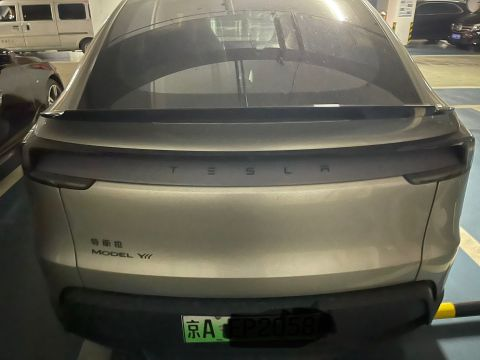

Caught a glimpse of the 6‑seat #TeslaModelYL in a Beijing garage today — a configuration that’s still unavailable in the EU. The setup is interesting: Champagne Gold exterior, 255/275 staggered tyres, six independent seats, and the 84/87 kWh battery pack that aligns with recent test data.Given the Nürburgring spy photos, the development cycle looks mature enough for a September–October appearance. Always exciting to see engineering progress up close before it reaches nordic markets.
#Beijing #TeslaModelYL #EV #6Seats

---

**Engagement:** 👍 1 likes • 💬 0 comments • 🔄 0 shares

*This post was automatically synced from LinkedIn on 11/19/2026.*

**Original LinkedIn Post:** [View on LinkedIn](https://www.linkedin.com/posts/hzl_teslamodelyl-beijing-teslamodelyl-activity-7485850892483735552-ylnn?utm_source=social_share_send&utm_medium=member_desktop_web&rcm=ACoAABWNEOYBdb1mUVFywmMzK0UKcw_6cTpqScY)
