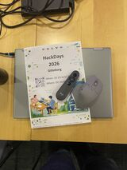

Excited to share that our team won a trophy at Volvo Group’s #2026HackDay after two days of intense collaboration. While we didn't take first place, it was still a proud win.

We launched #ClaimGenerationBot, an LLM-powered tool designed to boost efficiency, reduce labor costs, and accelerate claim generation. It’s rewarding to see it recognized and appreciated in action.

#Hackathon2026 #VolvoTruck #AI #LLM #ClaimGenerationBot

---

**Engagement:** 👍 33 likes • 💬 5 comments • 🔄 0 shares

*This post was automatically synced from LinkedIn on 11/19/2026.*

**Original LinkedIn Post:** [View on LinkedIn](https://www.linkedin.com/posts/hzl_2026hackday-claimgenerationbot-hackathon2026-activity-7475204067842027520-r3Q8?utm_source=social_share_send&utm_medium=member_desktop_web&rcm=ACoAABWNEOYBdb1mUVFywmMzK0UKcw_6cTpqScY)
