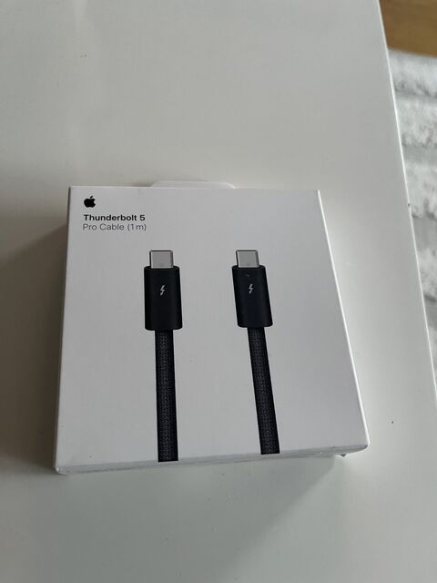

Finally, the #Thunderbolt5 cable arrived — time to stack my MacBook Pro with the Mac mini. But why does Apple’s Thunderbolt 5 cable cost $95? And why are people still willing to pay for it? It’s not just the Apple ecosystem — it’s also the trust built through years of reliable innovation and the weight of Apple‘s earned reputation. Even though we all know it’s essentially a premium Type-C cable made by Apple. 

#Thunderbolt5 #Apple #Stack #LocalLLM

---

**Engagement:** 👍 2 likes • 💬 0 comments • 🔄 0 shares

*This post was automatically synced from LinkedIn on 11/19/2026.*

**Original LinkedIn Post:** [View on LinkedIn](https://www.linkedin.com/posts/hzl_thunderbolt5-thunderbolt5-apple-activity-7497184207367217153-ikSM?utm_source=social_share_send&utm_medium=member_desktop_web&rcm=ACoAABWNEOYBdb1mUVFywmMzK0UKcw_6cTpqScY)
