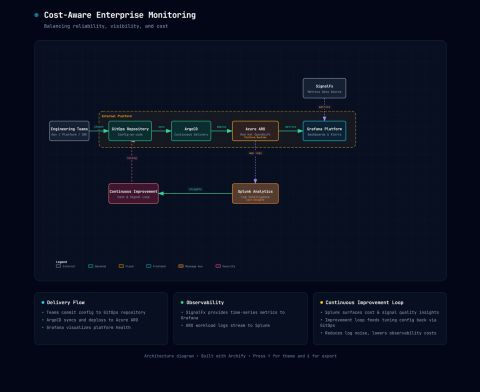

New Year, New Project #7

Grafana + Splunk on Azure ARO (Practical Enterprise Integration)

Many teams using Splunk today ask the same question: "Can we introduce Grafana without disrupting what already works?" The short answer is yes — if you design it as an integration strategy, not a tool replacement.

What we are implementing:
- GitOps-first delivery with ArgoCD
- Grafana on Azure ARO for operational dashboards and platform visibility
- Splunk retained for log intelligence and analysis
- Continuous feedback loop from Splunk findings to logging configuration tuning

Why this matters:
- Better signal quality
- Lower noise and unnecessary ingestion
- Faster troubleshooting for engineering teams
- Clearer ownership between platform and application layers

Observability is powerful. But unchecked, it becomes expensive noise. Here's the architecture we built to balance reliability, visibility, and cost:
→ Delivery — Teams push config to GitOps. ArgoCD syncs. ARO runs.
→ Observability — SignalFx feeds metrics into Grafana. Dashboards stay sharp.
→ Insight — App logs flow to Splunk. Patterns surface automatically.
→ The loop — Splunk insights feed back into logging config via GitOps. Less noise. Lower cost. Better signal.

The key insight: the feedback loop is the product. Without it, you're just paying more for more dashboards.

Built with: Azure Red Hat OpenShift · Grafana · SignalFx · Splunk · ArgoCD

This is not about "more monitoring tools." It is about building a monitoring model that is scalable, cost-aware, and enterprise-ready. If your organization is Splunk-first and considering Grafana, this path is realistic and incremental. 

#Grafana #Splunk #Azure #ARO #ArgoCD #GitOps #Observability #PlatformEngineering #SRE #CloudArchitecture

---

**Engagement:** 👍 0 likes • 💬 0 comments • 🔄 0 shares

*This post was automatically synced from LinkedIn on 11/19/2026.*

**Original LinkedIn Post:** [View on LinkedIn](https://www.linkedin.com/posts/hzl_grafana-splunk-azure-activity-7472690710711005184-GOpO?utm_source=social_share_send&utm_medium=member_desktop_web&rcm=ACoAABWNEOYBdb1mUVFywmMzK0UKcw_6cTpqScY)
